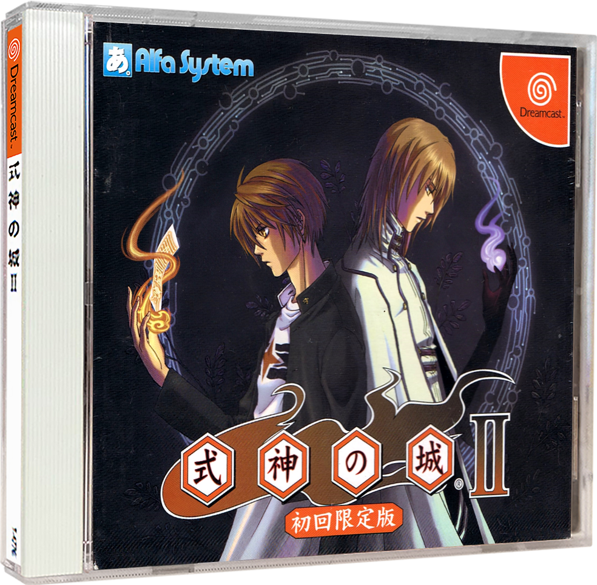
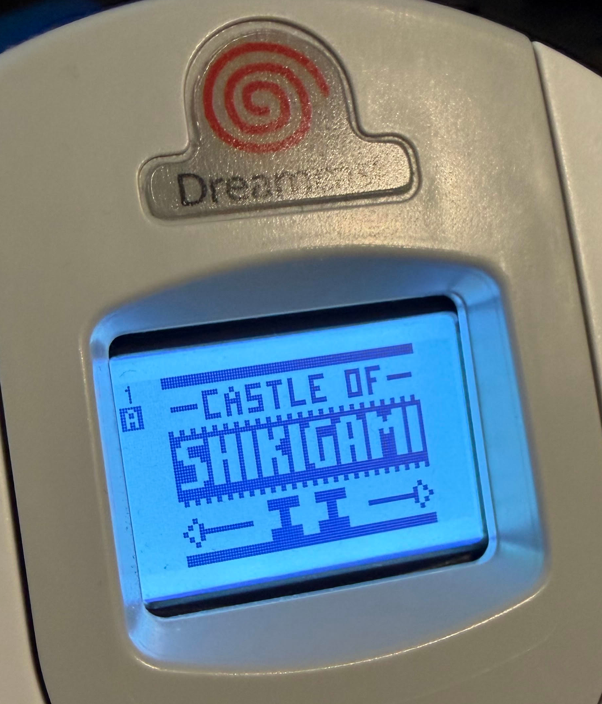
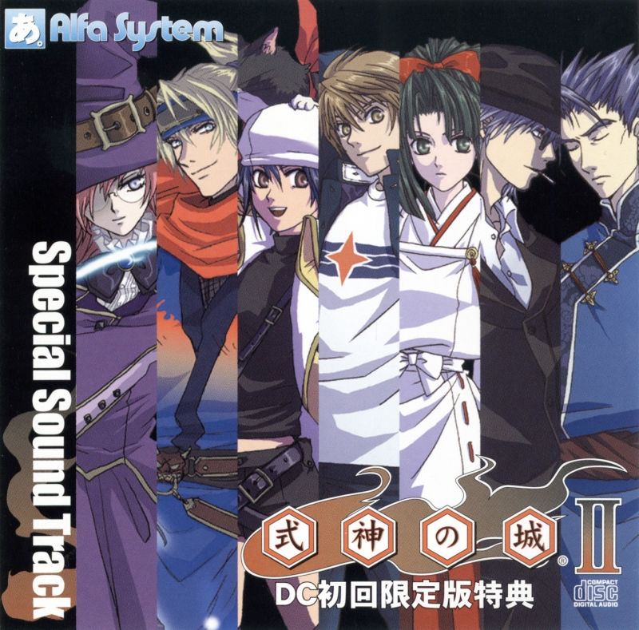

# Castle of Shikigami II
Download the English translation patch (more information in the [Patching Instructions](#patching-instructions) section).

- **GDI Format (Users of ODEs or Emulators)**
  - **Option 1**  
    Download [Castle of Shikigami II (English v1.0).dcp](https://github.com/DerekPascarella/CastleOfShikigamiII-EnglishPatchDreamcast/releases/download/1.0/Castle.of.Shikigami.II.English.v1.0.dcp) for use with [Universal Dreamcast Patcher](https://github.com/DerekPascarella/UniversalDreamcastPatcher) v1.3 or newer.
  - **Option 2**  
    Download [Castle of Shikigami II (English v1.0) [GDI].xdelta](https://github.com/DerekPascarella/CastleOfShikigamiII-EnglishPatchDreamcast/releases/download/1.0/Castle.of.Shikigami.II.English.v1.0.GDI.xdelta) for use with [Delta Patcher](https://www.romhacking.net/utilities/704/) (or equivalent tools).
- **CDI Format (Users Burning to CD-R)**  
  Download [Castle of Shikigami II (English v1.0) [CDI].xdelta](https://github.com/DerekPascarella/CastleOfShikigamiII-EnglishPatchDreamcast/releases/download/1.0/Castle.of.Shikigami.II.English.v1.0.CDI.xdelta) for use with [Delta Patcher](https://www.romhacking.net/utilities/704/) (or equivalent tools).

## Table of Contents

1. [Patching Instructions](#patching-instructions)
2. [Credits](#credits)
3. [Release Changelog](#release-changelog)
4. [Reporting Bugs and Typos](#reporting-bugs-and-typos)
5. [What's Changed](#whats-changed)
6. [About the Game](#about-the-game)
7. [Invincibility Mode](#invincibility-mode)
8. [Completed Save](#completed-save)
9. [Original Soundtrack](#original-soundtrack)

## Patching Instructions

- **GDI Format (Users of ODEs or Emulators) - DCP Patch**  
  The DCP patch file shipped with this release is designed for use with [Universal Dreamcast Patcher](https://github.com/DerekPascarella/UniversalDreamcastPatcher) v2.0 or newer. Note that Universal Dreamcast Patcher supports TOSEC-style GDI, Redump-style CUE, and CHD disc images as source input.

  1. The **Apply Patch** tab is selected by default.
  2. Next to **Source disc image**, click "Browse..." and select the `.gdi`, `.cue`, or `.chd` to be patched.
  3. Next to **Patch file**, click "Browse..." and select the `.dcp` patch file.
  4. Next to **Output folder**, click "Browse..." and select the folder where the patched GDI should be written.
  5. Click **Apply Patch**.

- **GDI Format (Users of ODEs or Emulators) - XDelta Patch**  
  The XDelta patch file shipped with this release can be used with any number of Delta utilities, such as [Delta Patcher](https://www.romhacking.net/utilities/704/). It targets `track03.bin` of the original TOSEC GDI. Ensure the source `track03.bin` file has an MD5 checksum of `C7D5CE7A2867D50D9B0B119758762264`.

  1. Click the settings icon (appears as a gear), enable **Checksum validation**, and disable **Backup original file**.
  2. Click the "Original file" browse icon and select the original `track03.bin` file.
  3. Click the "XDelta patch" browse icon and select the `Castle of Shikigami II (English v1.0) [GDI].xdelta` XDelta patch.
  4. Click "Apply patch" to overwrite the original `track03.bin` file with the patched version.
  5. Verify that the patched `track03.bin` file has an MD5 checksum of `36D3D84DC53DCDACE6E2ECCAB768C371`.

- **CDI Format (Users Burning to CD-R)**  
  The XDelta patch file shipped with this release can be used with any number of Delta utilities, such as [Delta Patcher](https://www.romhacking.net/utilities/704/). Ensure the source CDI has an MD5 checksum of `69FDEE18CF51255D92B9A2CBD3437D1E` (like the one found in the "DreamcastSelfBoot" repository).

  1. Click the settings icon (appears as a gear) and enable **Backup original file** and **Checksum validation**.
  2. Click the "Original file" browse icon and select the unmodified CDI.
  3. Click the "XDelta patch" browse icon and select the `Castle of Shikigami II (English v1.0) [CDI].xdelta` XDelta patch.
  4. Click "Apply patch" to generate the patched CDI in the same folder containing the original CDI.
  5. Verify that the patched CDI has an MD5 checksum of `A809587EC02E1968B78A176E5CFAA25F`.

## Credits

- **Programming / Hacking**
  - Derek Pascarella (ateam)
- **Translation**
  - Degica Games / Cosmo Machia Inc. (original Steam/Nintendo Switch re-release localization)
  - Walnut
- **Graphics**
  - Derek Pascarella (ateam)
- **Playtesting**
  - Perkin Warbeck
  - Lex J.V.B

## Release Changelog

- **Version 1.0 (2026-11-09)**
  - Initial release.

## Reporting Bugs and Typos

Even after extensive testing on both real hardware and on emulators, the presence of bugs or typos may be possible. Should a player encounter any such issue, it's kindly requested that they [submit a new issue](https://github.com/DerekPascarella/CastleOfShikigamiII-EnglishPatchDreamcast/issues/new) to this project page, including as much detailed information as possible.

## What's Changed

Below is a high-level list of changes implemented for this English translation patch.

- A new variable-width font has been implemented, and the game has been modified to natively interpret ASCII-encoded text in addition to the original Shift-JIS text encoding.
- All on-screen text has been translated and appears in English (story dialogue, menus and help text, tutorials, results and ranking screens, VMU save/load messages, and the staff roll).
  - Story dialogue is based on the Steam/Switch re-release localization with numerous fixes and improvements, rather than the original 2004 PlayStation 2 localization, and all dialogue missing from the re-release has been translated from scratch for this patch.
  - The story dialogue box has been expanded from two lines to three to hold more translated English text.
- All textures and graphics have been translated into English, including a brand-new "Castle of Shikigami II" logo for the title screen, arcade title screen, and in-game displays.
- Menu labels have been cleaned up for improved grammar and consistency (e.g., "OPTIONS" instead of "OPTION", "STORY REPLAY" instead of "STORY RECOLLECT", "BUTTON CONFIG" instead of "BUTTON ASSIGN").
- Character names use a consistent romanization throughout (e.g., "Kohtaro Kuga", "Gennojo Hyuga", "Daejeong Kim").
- Internet Ranking text has been translated to future-proof this patch for a potential online restoration in the future.
- VMU save file metadata has been translated and appears in English when viewed in the Dreamcast BIOS file manager, along with a brand-new English VMU icon and LCD artwork.
- A brand-new invincibility mode has been added to the options menu (see the [Invincibility Mode](#invincibility-mode) section).
- Analog stick support has been added for both players, with accurate 8-way movement and separate sensitivity tuning for gameplay and menus.
- Chibi Fumiko, originally selectable only through a hidden button combination, now has her own slot on the character select screen with a new name banner.
- Fixed broken 50hz mode on PAL consoles when not using VGA.

## About the Game

<table>
 <tr>
  <td><b>Original Title</b></td>
  <td>Shikigami no Shiro II (式神の城II)</td>
 </tr>
 <tr>
  <td><b>Localized Title</b></td>
  <td>Castle of Shikigami II</td>
 </tr>
 <tr>
  <td><b>Developer</b></td>
  <td><a href="https://en.wikipedia.org/wiki/Alfa_System">Alfa System</a></td>
 </tr>
 <tr>
  <td><b>Publisher</b></td>
  <td><a href="https://en.wikipedia.org/wiki/Alfa_System">Alfa System</a></td>
 </tr>
 <tr>
  <td><b>Release Date</b></td>
  <td>2004-03-25</td>
 </tr>
 <tr>
  <td><b>Supported Peripherals</b></td>
  <td>Controller, Arcade Stick, Jump Pack, VGA Box, VMU</td>
 </tr>
</table>

"Castle of Shikigami II" (式神の城II) is a vertically scrolling shoot-'em-up developed by Alfa System. Originally released on Sega NAOMI arcade hardware in 2003, the game was subsequently ported to the Sega Dreamcast and released in Japan on March 25th, 2004. A limited edition of the Dreamcast release was bundled with a soundtrack CD.

The story takes place in December 2006, when a massive flying castle appears in the skies above Tokyo. Players choose from eight characters, including newcomers Niigi Gorgeous Blue and Roger Sasuke, each with their own reasons for storming the castle. Every possible pairing of characters in two-player mode features its own unique story dialogue between stages.

Central to the gameplay is the Tension Bonus System, which rewards players for flying dangerously close to enemies and their bullets with stronger attacks and a score multiplier of up to x8. Each character also wields two shot types and a unique shikigami attack. The Dreamcast version supports vertical (TATE) display modes for rotated monitors, along with Story Replay, Practice, and Gallery modes unlocked through play.

The game was also released on the GameCube, PlayStation 2, Xbox, and Windows. Only the PlayStation 2 version was released outside of Japan, published in North America by XS Games in 2004 as "Castle Shikigami 2". In 2021, Degica Games released "Castle of Shikigami 2" on Steam with a brand-new English translation, followed by a Nintendo Switch release in 2023.

## Invincibility Mode

A brand-new invincibility mode has been implemented for this English translation patch to aid players who are interested in experiencing the story of "Castle of Shikigami II" regardless of their shoot-'em-up skill level.

To take advantage of this new feature, a player can navigate to **OPTIONS** from the title screen menu, then select **INVINCIBLE** and toggle the setting to "ON" or "OFF".

When invincibility is active, enemy attacks no longer hit the player. Note that this setting is not saved to the VMU, and resets to "OFF" each time the game is powered on.

## Completed Save

Much of the extra content in "Castle of Shikigami II" is unlocked through extended play, such as the Practice and Story Replay modes, the EXTRA OPTIONS menu, every image in the Gallery, and the FREE PLAY setting.

For convenience, a completed save file is available here with all of this content unlocked. Since this save was created for this English translation patch, its VMU file name and icon appear in English.

- **[GAME.VMU](https://github.com/DerekPascarella/CastleOfShikigamiII-EnglishPatchDreamcast/raw/refs/heads/main/vmu_save_files/GAME.VMU)**  
  A VMU dump usable in emulators or with devices like the [VM2](https://www.dreammods.net/store/p6/VM2.html), [VMU Pro](https://8bitmods.com/vmupro-handheld-visual-memory-card-for-dreamcast-classic-white/), [USB4MAPLE](http://usb4maple.wikidot.com/), or [Pico2Maple](https://github.com/cluoma/Pico2Maple-fw).
- **[SIKIGAMI.VMI](https://github.com/DerekPascarella/CastleOfShikigamiII-EnglishPatchDreamcast/raw/refs/heads/main/vmu_save_files/SIKIGAMI.VMI) + [SIKIGAMI.VMS](https://github.com/DerekPascarella/CastleOfShikigamiII-EnglishPatchDreamcast/raw/refs/heads/main/vmu_save_files/SIKIGAMI.VMS)**  
  A VMI/VMS pair that can be imported into an existing VMU dump using a tool like [VMU Explorer](https://segaretro.org/VMU_Explorer), or downloaded directly to a real hardware VMU using a tool like [VMU Disc Builder](https://github.com/DerekPascarella/VMU-Disc-Builder).

## Original Soundtrack

On March 25th, 2004, Alfa System released the original soundtrack alongside the game itself, bundled with the first-print limited edition of the Dreamcast release. Titled "Shikigami no Shiro II - Special Sound Track", the album features a total of 36 tracks on a single disc. The first 19 tracks, from "Theme Of Shikigami" through "reborn", are music composed by Yoichi Shimamura. The remaining 17 are voice tracks: a short clip for each member of the cast, performed by voice actors such as Yui Horie, Daisuke Kishio, and Yukari Tamura, followed by three "World Order" tracks performed by Naoki Yanagi.

To learn more about the soundtrack, including the full track listing, visit its entry on [VGMdb](https://vgmdb.net/album/9096).

[Download](https://mega.nz/folder/uVlXzIgL#fAH2bOK6M38aZWuiWQc8CA) the soundtrack in MP3 and FLAC formats, including a burnable disc image.
